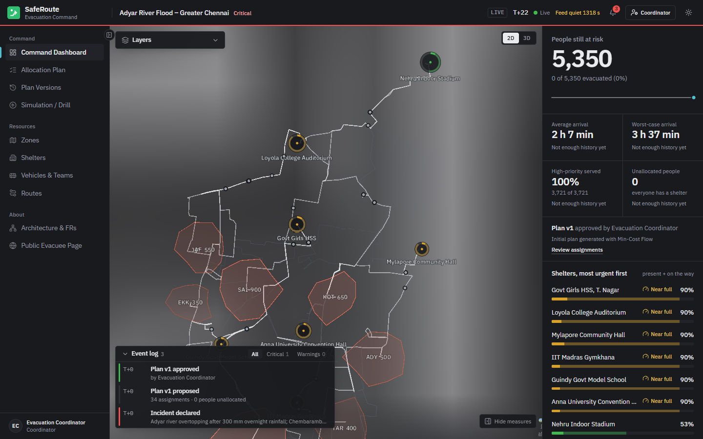

# SafeRoute – Disaster Evacuation & Shelter Allocation System

[](https://github.com/OWNER/REPO/actions/workflows/ci.yml)
<!-- Replace OWNER/REPO with the GitHub path of this repository once it is pushed. -->

Software Engineering Lab project, JSS University Noida, Department of CSE (AI/ML).
Team: Bhoomika, Akshita Upadhyay, Neel Tripathi, Tanishq Saxena.

SafeRoute is a decision-support system for emergency authorities. After a disaster has been declared it
keeps track of affected zones, households, shelters, routes, vehicles and teams. It proposes an evacuation
plan that respects hard constraints and explains every assignment, and it re-plans when a road floods or
a shelter fills up. A person always approves or overrides the plan. SafeRoute does not predict disasters.



## How it fits together

```
React UI (frontend/)  ── REST + WebSocket ──>  FastAPI (backend/app/api)
                                                   │
                                     Services (backend/app/services)
                                       │                     │
                     Engine, pure Python (app/engine)   Repositories (app/repositories)
                                                             │
                                                   PostgreSQL (live + drill)
Live feed ── POST /api/v1/ingest ──> Ingestion adapter (app/ingestion) ──> Services
```

* **PostgreSQL is the source of truth.** Every screen reads it through the API. After each write the
  backend pushes a `changed` message over `/ws`, and the browser refetches what changed.
* **One map.** The CesiumJS map on the Command Dashboard is the map everywhere: in the Drill, Zones,
  Shelters, Routes, Vehicles, Field and Public pages, as a smaller frame.
* **Drills never touch live data.** A drill copies the live database into `saferoute_drill` and runs
  there, and the top bar shows `DRILL`.
* **No mock data in the app.** The only fallback is a recorded feed replay for development
  (`REPLAY_FEED=true`, off by default), shown as `REPLAY` in the top bar.

Architecture diagram and the layer → folder mapping: [docs/exp04](docs/exp04/exp-04.md).

## Run it

### With Docker

```bash
docker compose up --build
```

Then open http://localhost:5173 and use one of the lab accounts on the login page. The backend container
migrates both databases and seeds the Chennai Adyar flood scenario on first start. The API docs are at
http://localhost:8000/docs.

> The Docker files were written but not run on the development machine, which has no Docker. The local
> setup below is the one that was tested.

### Local (tested)

You need Python 3.12, Node 22 or newer and PostgreSQL 16.

```bash
# 1. databases
createdb -U postgres saferoute
createdb -U postgres saferoute_drill

# 2. backend
python -m venv .venv && .venv\Scripts\activate          # source .venv/bin/activate on Linux/macOS
pip install -r backend/requirements-dev.txt
cd backend
copy .env.example .env                                   # cp on Linux/macOS; defaults work locally
alembic upgrade head
alembic -x db=drill upgrade head
python -m app.seed                                       # empties and seeds the live database
uvicorn app.main:app --port 8000

# 3. frontend (new terminal)
cd frontend
npm install
npm run dev                                              # http://localhost:5173
```

### Lab accounts

| Role | Email | Password |
|---|---|---|
| Admin | admin@saferoute.org | Admin@12345 |
| Evacuation Coordinator | coordinator@saferoute.org | Coord@12345 |
| Emergency Authority | commander@saferoute.org | Command@12345 |
| Shelter Manager (T. Nagar) | shelter.tnagar@saferoute.org | Shelter@12345 |
| Transport Coordinator | transport@saferoute.org | Transport@12345 |
| Response Team | field.alpha@saferoute.org | Field@12345 |
| Relief Staff | relief@saferoute.org | Relief@12345 |
| NGO Volunteer | ngo@saferoute.org | Ngo@12345 |

These are seed data for the lab. Set `DEMO_ACCOUNTS=false` to hide them from the login page.

## Tests

```bash
cd backend && pytest --cov=app             # 332 cases: engine, services, API on a real PostgreSQL
cd frontend && npm test                    # Vitest
cd frontend && npm run e2e                 # Playwright: every page for all 8 roles (needs both servers)
```

The backend tests create `saferoute_test` and `saferoute_test_drill` themselves. CI
([.github/workflows/ci.yml](.github/workflows/ci.yml)) runs ruff, pytest with coverage (it fails under
80%), ESLint, Vitest and the production build on every push and pull request.

## Documentation

| | |
|---|---|
| Lab file (Word + PDF) | [docs/lab-file](docs/lab-file/SafeRoute_Lab_File.pdf) |
| Lab experiments 1–12 | [docs/exp01](docs/exp01/exp-01.md) … [docs/exp12](docs/exp12/exp-12.md) |
| UML (PlantUML sources + images) | [docs/uml](docs/uml) |
| Database schema | [docs/db/schema.sql](docs/db/schema.sql) |
| User manual (per role) | [docs/exp12/user-manual.md](docs/exp12/user-manual.md) |
| How we work | [CONTRIBUTING.md](CONTRIBUTING.md) |

## Known limits

* The map basemap and the OSRM road service are online services; with no internet the map shows no
  basemap tiles (the data layers still draw).
* There is no real public feed for Chennai yet. Feeds post to `/api/v1/ingest`; for development the
  recorded feed in `backend/app/ingestion/samples` can be replayed.
* More in [docs/exp12](docs/exp12/exp-12.md#limitations).
