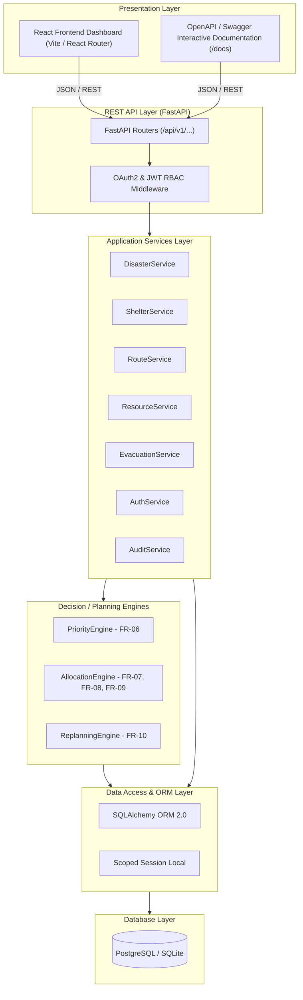

# SafeRoute – Disaster Evacuation & Shelter Allocation System
### Software Engineering Lab Project | JSS University, Noida
**Department of Computer Science and Engineering (AI/ML)**

---

## 👥 Project Team

| Name | Admission Number | Role / Contributions |
| :--- | :--- | :--- |
| **Bhoomika** | `J240211026` | Requirements Analysis & UML Modeling |
| **Akshita Upadhyay** | `J240211005` | Backend Architecture, API Development & Decision Engines |
| **Neel Tripathi** | `J240211049` | Database Schema Design, Normalization & SQL Layer |
| **Tanishq Saxena** | `J240211060` | Testing, QA Verification & CI Pipeline |

---

## 📌 Project Overview
**SafeRoute** is a decision-support system designed to assist emergency management authorities in coordinating post-disaster evacuations during floods, earthquakes, industrial fires, and cyclones. Rather than attempting to predict disasters, SafeRoute focuses on **operational resource allocation**, calculating optimal evacuation priorities, matching affected populations to suitable shelters under capacity and route constraints, and dynamically re-planning evacuation routes when roads become flooded, blocked, or damaged.

### 🌟 Core Highlights
- **Priority Calculation Engine (FR-06)**: Ranks affected zones using weighted factors including disaster severity, local risk levels, urgency codes, and population density.
- **Constraint-Based Shelter Allocation (FR-07 & FR-08)**: Applies hard constraints (active shelter, open unblocked route, capacity headroom) and multi-factor suitability scoring (distance, travel time, route risk, remaining shelter headroom).
- **Dynamic Replanning & Contingency Engine (FR-10)**: Real-time reallocation when a route becomes blocked or a shelter reaches full capacity, safely rerouting evacuees and releasing previous resource locks.
- **Role-Based Access Control (RBAC & JWT - FR-11)**: Fine-grained security for Administrators, Emergency Authorities, Evacuation Coordinators, Shelter Managers, Transport Coordinators, and Response Teams.
- **Audit Trails & Notification Dispatch (FR-12)**: End-to-end event logging and stakeholder alerts.
- **Emergency Monitoring Dashboard API**: Real-time aggregated metrics for evacuation progress, shelter occupancy, vehicle deployment, and active alerts.

---

## 🛠️ Technology Stack

| Layer | Technology | Details |
| :--- | :--- | :--- |
| **Backend Framework** | **Python + FastAPI** | Asynchronous, OpenAPI auto-documentation, high performance |
| **ORM & Data Layer** | **SQLAlchemy 2.0** | Relational mapping, connection pooling, check constraints |
| **Database** | **PostgreSQL / SQLite** | Seamless SQLite plug-and-play for local dev; PostgreSQL for production |
| **Security & Auth** | **PyJWT + Bcrypt** | Salted password hashing, JWT bearer tokens, RBAC dependencies |
| **Testing Suite** | **PyTest + HTTPX** | Unit tests for engines + integration tests for REST APIs |
| **CI / CD** | **GitHub Actions** | Automated linting, test suite execution, build checks on push/PR |
| **Design / UML** | **Mermaid & PlantUML** | Architecture, Sequence, Class, Activity, and ER diagrams |

---

## 🏛️ System Architecture

SafeRoute follows a strict layered software architecture ensuring low coupling and high maintainability:



---

## 📊 Database Schema & Constraints (ER Design)

SafeRoute implements strict database constraints and satisfies **3rd Normal Form (3NF)**:
- **Primary & Foreign Keys**: Enforces relational integrity across disasters, zones, shelters, routes, vehicles, and assignments.
- **Check Constraints**:
  - `Capacity > 0` (Shelters and vehicles must have positive capacities)
  - `Occupancy >= 0` and `Occupancy <= Capacity` (Shelters cannot exceed physical capacity)
  - `People_Count > 0` (Evacuation assignments must have positive evacuee counts)
  - `Population >= 0` (Zone population non-negative)
- **Unique Constraints**: Unique user email addresses, route source-destination pairs, etc.

Detailed diagrams are available in [`docs/UML_DIAGRAMS.md`](docs/UML_DIAGRAMS.md).

---

## 🚀 Quick Start Guide

### 1. Prerequisites
- Python 3.10+ (Python 3.11 or 3.13 tested)
- Git

### 2. Clone and Setup Environment
```bash
git clone https://github.com/akshitaupadhyay/SafeRoute-Backend.git
cd SafeRoute-Backend

# Create and activate virtual environment
python -m venv venv
# On Windows:
.\venv\Scripts\activate
# On Linux/macOS:
source venv/bin/activate

# Install dependencies
pip install -r requirements.txt
```

### 3. Environment Variables
Copy `.env.example` to `.env`:
```bash
cp .env.example .env
```
*Note: SQLite is preconfigured by default (`sqlite:///./saferoute.db`), so the backend runs immediately without installing external database servers.*

### 4. Run Backend Server
```bash
python run.py
```
Or with Uvicorn directly:
```bash
uvicorn app.main:app --host 0.0.0.0 --port 8000 --reload
```

The API will be live at:
- 🔗 API Base URL: `http://localhost:8000`
- 📖 Interactive Swagger API Docs: `http://localhost:8000/docs`
- 📑 ReDoc Documentation: `http://localhost:8000/redoc`

---

## 🔑 Default Seeded Credentials

Upon startup, the database automatically seeds two test administrative accounts:

| Role | Email | Password |
| :--- | :--- | :--- |
| **System Administrator** | `admin@saferoute.org` | `Admin@12345` |
| **Evacuation Coordinator** | `coordinator@saferoute.org` | `Coord@12345` |

---

## 🧪 Running Automated Tests

Run the complete PyTest test suite (11 unit & integration tests):
```bash
pytest -v
```

### Test Coverage Highlights:
- ✅ `tests/test_auth.py`: Registration, JWT authentication, invalid credentials, RBAC.
- ✅ `tests/test_disasters_zones.py`: Disaster incident management & affected zone registration.
- ✅ `tests/test_shelters_routes.py`: Shelter capacity updates, facility tracking & route status management.
- ✅ `tests/test_allocation_engine.py`: Population priority ranking (FR-06) and constraint-based exclusion of full shelters and blocked routes (FR-07).
- ✅ `tests/test_dynamic_replanning.py`: Real-time reallocation when a route becomes blocked or flooded (FR-10).
- ✅ `tests/test_api_integration.py`: End-to-end evacuation plan generation and monitoring dashboard summary.

---

## 📁 Project Directory Structure

```
SafeRoute-Backend/
├── .github/
│   └── workflows/
│       └── ci.yml                 # Automated CI Workflow
├── app/
│   ├── core/
│   │   ├── database.py            # Database engine & session management
│   │   ├── dependencies.py        # RBAC and Auth dependencies
│   │   └── security.py            # Bcrypt hashing & JWT utilities
│   ├── engines/
│   │   ├── priority_engine.py     # FR-06 Priority scoring
│   │   ├── allocation_engine.py   # FR-07, FR-08, FR-09 Constraint-based allocation
│   │   └── replanning_engine.py   # FR-10 Dynamic reallocation
│   ├── models/                    # SQLAlchemy ORM models (1NF, 2NF, 3NF)
│   ├── routers/                   # Modular REST endpoints
│   ├── schemas/                   # Pydantic v2 validation models
│   ├── services/                  # Application business services
│   ├── config.py                  # Pydantic BaseSettings
│   └── main.py                    # Application entry point & Lifespan setup
├── docs/
│   └── UML_DIAGRAMS.md            # Mermaid & PlantUML diagrams
├── tests/                         # PyTest automated test suite
├── .env.example
├── .gitignore
├── pytest.ini
├── requirements.txt
├── run.py
└── README.md
```

---

## 📜 License
This project is developed as part of the Software Engineering Lab curriculum for **JSS University, Noida**. Open-source academic use.
