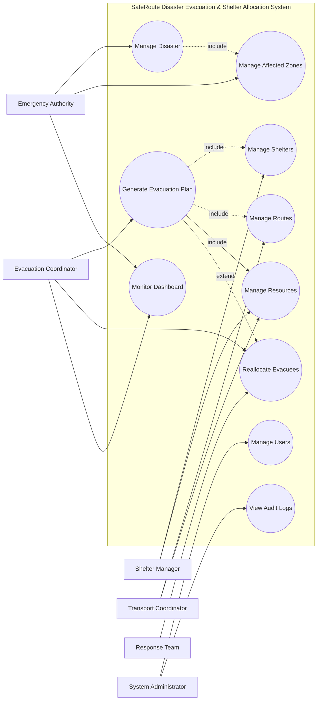
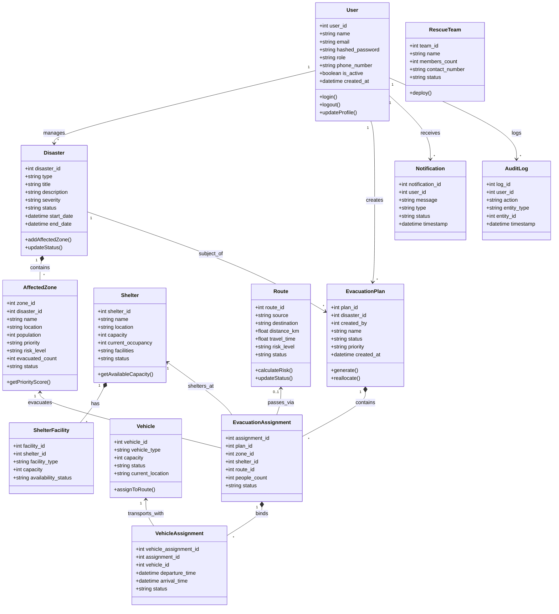
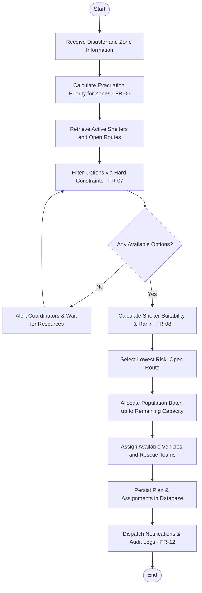
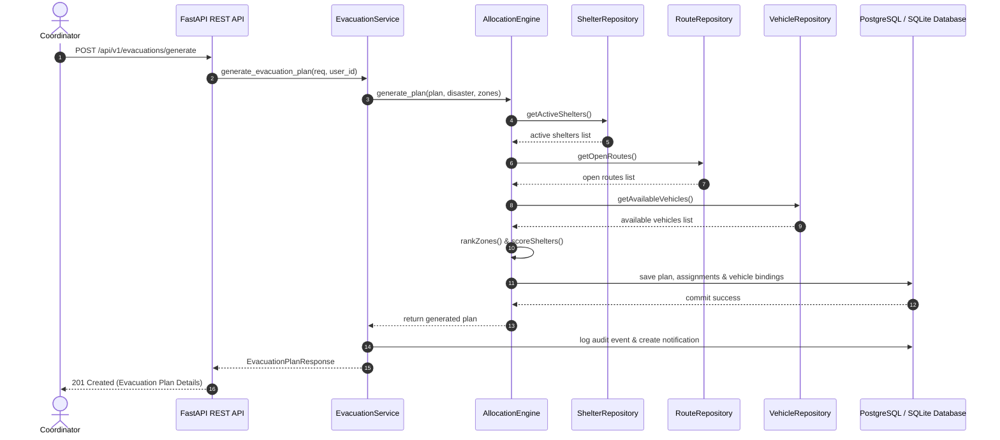
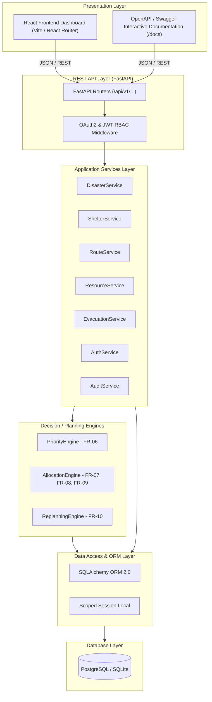
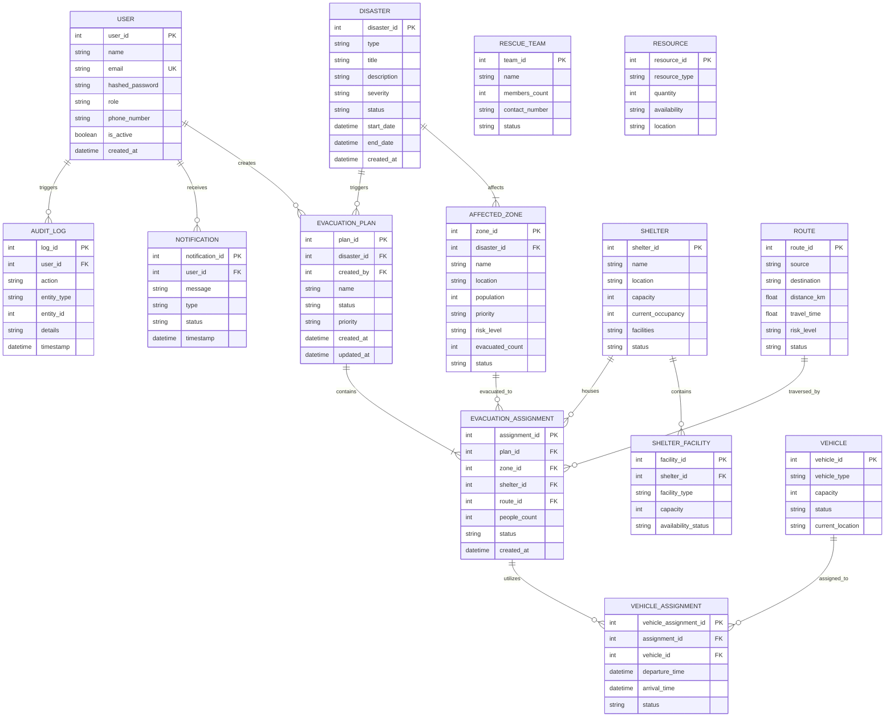

# SafeRoute – Software Engineering UML & Design Diagrams

## 1. Use Case Diagram

---

## 2. Class Diagram

---

## 3. Activity Diagram – Generate Evacuation Plan

---

## 4. Sequence Diagram – Create Evacuation Plan

---

## 5. Architectural Design (Layered Architecture)

---

## 6. Entity-Relationship (ER) Diagram

