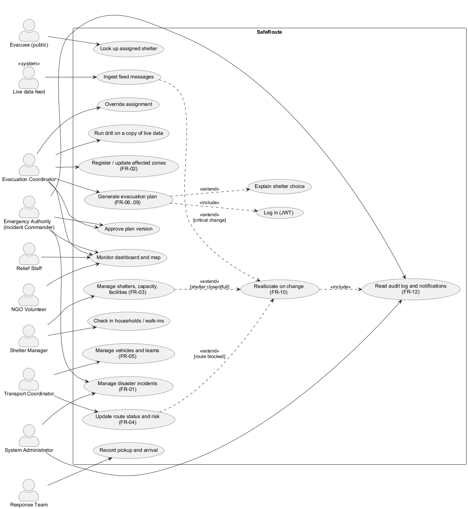
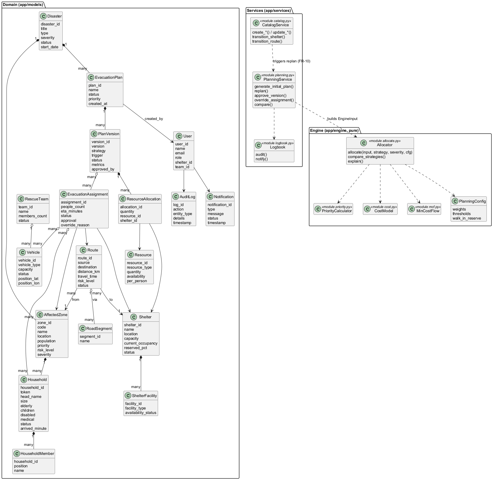
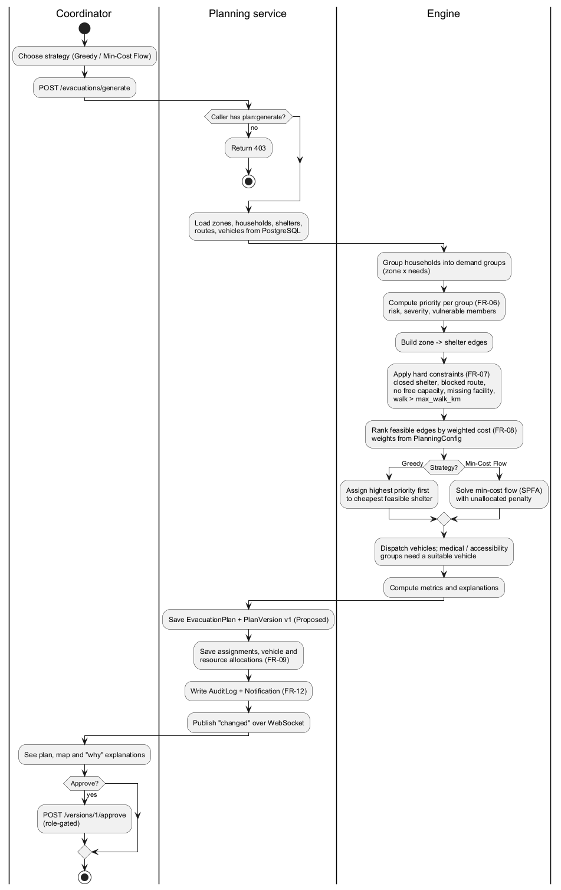
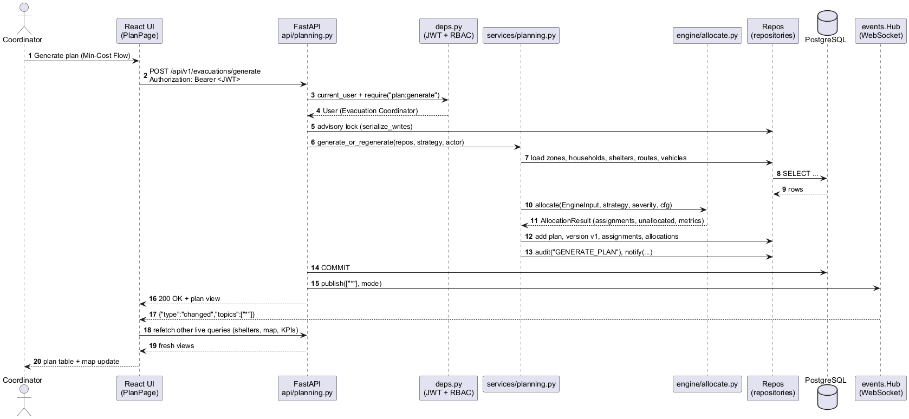

# Experiment 3 – UML Diagrams

## Objective

To model the functional and structural behavior of SafeRoute using standard UML diagrams.

## Procedure

1. Wrote each diagram as PlantUML text in [`docs/uml`](../uml), so the diagrams are versioned and
   reviewed like code.
2. Rendered them locally with PlantUML 1.2024.7 on Java 21:
   ```bash
   java -jar plantuml.jar -tpng -o out docs/uml/*.puml
   java -jar plantuml.jar -tsvg -o out docs/uml/*.puml
   ```
3. Checked them against the implementation. Every attribute name on the class diagram was compared with
   the SQLAlchemy model columns by a script, and the wrong names were corrected.

## Output

### A. Use case diagram – main actors

Source: [`use-case.puml`](../uml/use-case.puml)



### B. Class diagram – core classes

Source: [`class.puml`](../uml/class.puml). Domain classes are the tables in `backend/app/models`. The
service and engine classes are the modules that act on them.



### C. Activity diagram – generate evacuation plan

Source: [`activity.puml`](../uml/activity.puml)



### D. Sequence diagram – create evacuation plan

Source: [`sequence.puml`](../uml/sequence.puml)



### Design changes since the lab file

What the implementation changed compared with the first diagrams, and why:

| Change | Why |
|---|---|
| Added **Household** and **HouseholdMember** | FR-06 needs the number of elderly, children, disabled and medical people per family. Check-in and the public lookup also work per family (token on the slip). A family is never split. |
| Added **PlanVersion** (and the link table plan_version_assignments) | FR-10: each re-plan saves a new *Proposed* version with a diff, so the coordinator can see what moved and approve it. Old versions stay for audit. |
| Facilities moved from a Shelter attribute to **ShelterFacility** | One value per field (1NF). A single facility can be marked Limited or Unavailable, which drives re-planning. |
| Added **RoadSegment** / route_segments | Several routes cross the same bridge. One "bridge flooded" report must block all of them (TC-API-13). |
| Route links a zone to a shelter by key (zone_id, shelter_id), not only Source/Destination text | Allocation needs the route between a specific zone and shelter. The text fields are kept for display. |
| Added **VehicleAssignment**, **RescueTeam**, **ResourceAllocation**, **AssignmentHousehold** | FR-05 and FR-09: which vehicles carry which families, and which supplies go to which shelter. |
| Notification links to the AuditLog entry that caused it (log_id) | FR-12: an alert can be traced to the action behind it. |
| Two read-only roles: **Relief Staff**, **NGO Volunteer** | They are stakeholders in the SRS. They can watch the dashboard and plan but change nothing. |
| Added **OpsState**, **OpsEvent**, **IngestLog** | Live operation: the drill clock, the event feed on the dashboard, and the record of every feed message. |
| A separate drill database | A drill copies live data and runs on the copy, so practice never changes real records (TC-API-27). |

## Conclusion

The four diagrams describe the system as built, not only as planned. Keeping them as PlantUML next to the
code means a change to the design is a reviewed diff.
