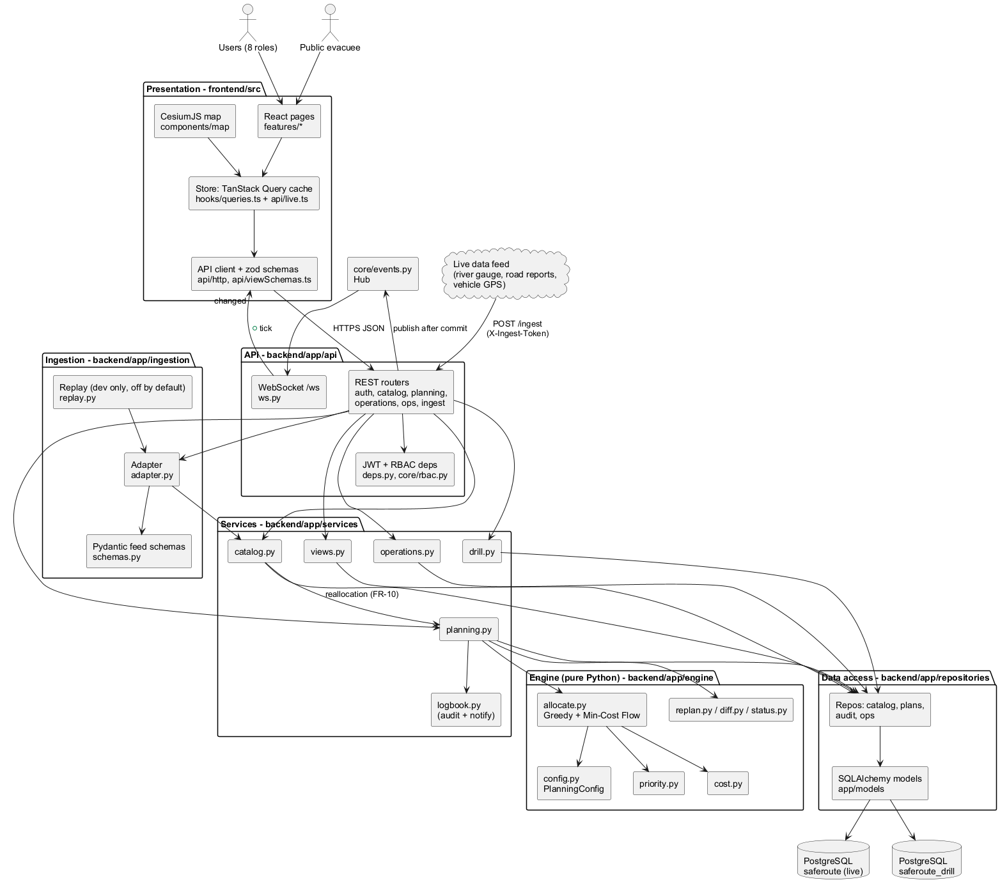

# Experiment 4 – Architectural Design

## Objective

To design a maintainable layered architecture that separates presentation, API, business services,
decision logic and data access.

## Procedure

1. Split the system into layers, each allowed to call only the layer below it.
2. Put each layer in its own folder, so the structure of the code is the architecture.
3. Drew the architecture in PlantUML ([`architecture.puml`](../uml/architecture.puml)) from the real
   folders and modules.
4. Kept the decision engine free of database and web code so it can be unit tested on its own.

## Output

### Architecture diagram

### Layer → folder mapping

| Layer | Folder | Responsibility | Talks to |
|---|---|---|---|
| Presentation | `frontend/src/features`, `frontend/src/components` | Pages per role, the CesiumJS map, forms | Store |
| Client store | `frontend/src/hooks/queries.ts`, `frontend/src/api` | TanStack Query cache fed by REST. The WebSocket (`api/live.ts`) says when to refetch. zod checks every response | REST API, `/ws` |
| API | `backend/app/api` | REST routers and the `/ws` WebSocket; JWT and role checks (`deps.py`); commit, then publish "changed" | Services |
| Ingestion | `backend/app/ingestion` | Validates feed messages with Pydantic and applies them through services; logs each one in ingest_log | Services |
| Services | `backend/app/services` | Use cases: planning, catalog CRUD and status transitions, field and check-in operations, drills, read views, audit and notifications | Engine, repositories |
| Engine | `backend/app/engine` | Pure Python: priority, cost, feasibility, Greedy and Min-Cost Flow allocation, re-plan, diff, shelter status. No database or HTTP imports | Nothing (input → output) |
| Data access | `backend/app/repositories`, `backend/app/models` | Repository classes over SQLAlchemy models | PostgreSQL |
| Database | PostgreSQL 16: `saferoute` (live), `saferoute_drill` | Source of truth; schema managed by Alembic (`backend/alembic`) | – |
| Cross-cutting | `backend/app/core` | Settings, database engines and write lock, security, RBAC table, event hub | Used by every backend layer |

### How data moves

* **A user action** (for example, a coordinator closes a shelter) goes from the page through
  `PUT/POST /api/v1/...`. The router checks the role, the service validates the transition, and the
  service asks the engine for a re-plan. Repositories write the new plan version, the audit entry and
  the notification. After the commit, the hub publishes `changed`, and every open browser refetches.
* **A feed message** (`POST /api/v1/ingest` with the `X-Ingest-Token` header) follows the same service
  path, so a report from the field and a click in the UI have the same effect.
* **A drill** copies the live database into `saferoute_drill`. Requests then use the drill database
  until the drill ends. Live data is never written by a drill.

### Design rationale

* Layer separation reduces coupling and improves maintainability.
* The allocation engine can be unit tested independently: the 36 engine test functions run without a
  database.
* Repository classes isolate database operations from business logic. Service tests replace them with
  fakes (TC-SVC-01..09).
* REST APIs allow the frontend to evolve independently. The frontend validates every response with zod,
  so a backend change that breaks the contract fails loudly.
* The architecture is modular without the deployment complexity of true microservices: one backend
  process, one database server.
* Concurrent writes (the drill clock, feed messages, users) take a PostgreSQL advisory lock
  (`serialize_writes`). This removed a deadlock found during testing (see the
  [debugging log](../exp12/debugging-log.md)).

## Conclusion

The layered design is visible in the folder structure, and the tests follow the same split: pure engine
tests, service tests with fakes, and API tests on a real database.
