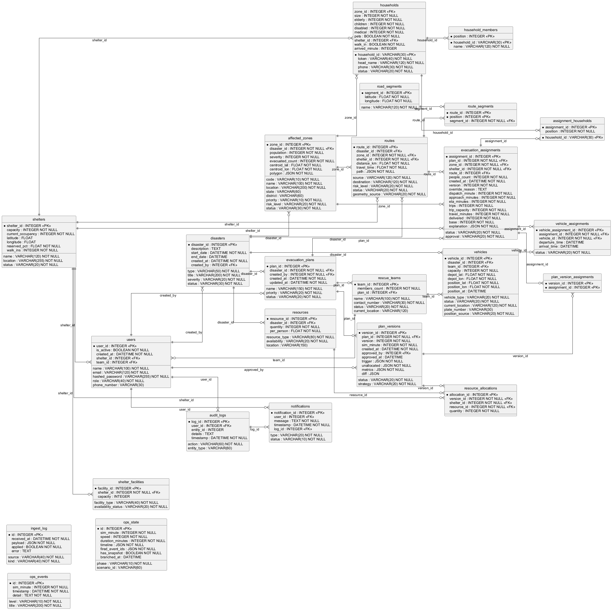

# Experiment 5 – Database Design: ER Diagram and Relational Schema

## Objective

To design a structured relational database for SafeRoute using an Entity–Relationship (ER) diagram and a
relational schema, ensuring data integrity, consistency, and efficient retrieval of disaster, shelter,
route, vehicle, and evacuation assignment information.

## Procedure

1. Started from the entities in the lab file (User, Disaster, AffectedZone, Shelter, Route, Vehicle,
   EvacuationPlan, Assignment, Resource, Notification, AuditLog).
2. Wrote them as SQLAlchemy 2 models (`backend/app/models`) with primary keys, foreign keys,
   NOT NULL, UNIQUE and CHECK constraints.
3. Created the schema with Alembic migrations (`backend/alembic/versions`):
   * `0001_initial_schema.py`: all tables and constraints;
   * `0002_household_arrived_minute.py`: arrival time per household, used by the dashboard timeline.
4. Exported the real schema from PostgreSQL 16.6:
   ```bash
   pg_dump --schema-only --no-owner --no-privileges -U postgres saferoute > docs/db/schema.sql
   ```
5. Generated the ER diagram from the same models (`python ../docs/uml/gen_er.py`, run in `backend/`),
   so it cannot drift from the schema.
6. Seeded the database with the labelled seed script (`python -m app.seed`). Its data module starts with
   "SEED DATA - not live data".

## Output

### Relational schema

* [`docs/db/schema.sql`](../db/schema.sql): 25 application tables (plus Alembic's `alembic_version`) and
  50 CHECK constraints.

| Group | Tables |
|---|---|
| Lab entities | users, disasters, affected_zones, shelters, routes, vehicles, evacuation_plans, evacuation_assignments, resources, notifications, audit_logs |
| Added in implementation (see [Exp 3 design changes](../exp03/exp-03.md#design-changes-since-the-lab-file)) | households, household_members, shelter_facilities, road_segments, route_segments, rescue_teams, plan_versions, plan_version_assignments, vehicle_assignments, assignment_households, resource_allocations |
| Live operation | ops_state, ops_events, ingest_log |

### ER diagram

Source: [`er.puml`](../uml/er.puml) (generated) · [SVG](../uml/out/er.svg)



### Constraints (examples from schema.sql)

| Rule from the lab file | Constraint in the database |
|---|---|
| Capacity > 0 | `chk_shelter_capacity_positive CHECK (capacity > 0)` |
| Occupancy ≥ 0 | `chk_shelter_occupancy_non_negative CHECK (current_occupancy >= 0)` |
| Occupancy must not exceed capacity | `chk_shelter_occupancy_lte_capacity CHECK (current_occupancy <= capacity)` |
| People_Count > 0 | `chk_assignment_people_count_positive CHECK (people_count > 0)` |
| Assignments reference valid shelters and zones | foreign keys evacuation_assignments.zone_id → affected_zones, .shelter_id → shelters, .route_id → routes |
| Allowed values only | e.g. `chk_route_status` (Open, Congested, Blocked, Flooded, Cleared), `chk_user_role` (8 roles), `chk_zone_severity_range` (1–5) |
| UNIQUE | e.g. users.email, households.token, (plan_id, version) on plan_versions |

TC-SVC-07 checks that the service rejects occupancy above capacity before the database has to.

### Normalization

* **1NF – one value per field, no repeating groups.** The lab's `Facilities` attribute on Shelter
  would hold a list ("medical, power, water"). It became the table shelter_facilities, one row per
  facility, with its own availability. Household members are rows in household_members, not a list
  column. Routes and the road segments they cross are linked through route_segments.
* **2NF – no partial dependency on part of a key.** Link tables with composite keys hold only the link,
  for example plan_version_assignments (version_id, assignment_id) and assignment_households.
  Facts about an assignment (people_count, eta_minutes, status) live in evacuation_assignments, keyed by
  assignment_id alone.
* **3NF – no transitive dependency.** An assignment stores shelter_id, not the shelter's name or
  capacity. Those live only in shelters, so renaming a shelter or changing its capacity is one update.
  Shelter status shown to users ("Near Full", "Full") is computed from occupancy, inbound people and
  the thresholds in `PlanningConfig`, not stored a second time.
* **Deliberate exceptions.** `plan_versions.metrics` and `diff` are JSON snapshots taken when the
  version was created. They record history and must not change when the data changes later.
  `routes.source` and `destination` keep display text next to the keys.

These rules prevent update anomalies (a shelter renamed in one place but not another), insertion
anomalies (a facility can be recorded without inventing a plan), and deletion anomalies (deleting an
assignment does not delete the shelter).

### Design rationale

1. A relational database provides structured storage for disaster management data.
2. Primary and foreign keys maintain data integrity.
3. Normalization reduces unnecessary data duplication.
4. Separate tables make it easier to update shelter, route, and vehicle information.
5. The schema supports evacuation planning, resource allocation, and dynamic reallocation.

## Conclusion

The schema in PostgreSQL implements every entity in the lab design, enforces the lab's integrity rules
as real constraints, and is versioned with Alembic. The ER diagram is generated from the same models,
so it shows the database as it is.
