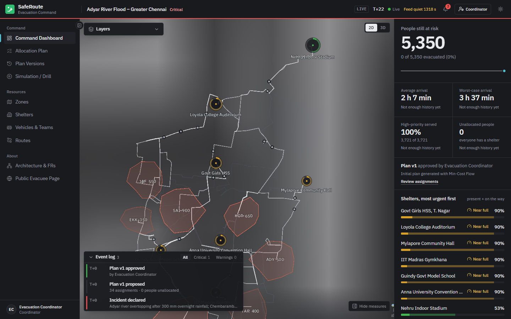
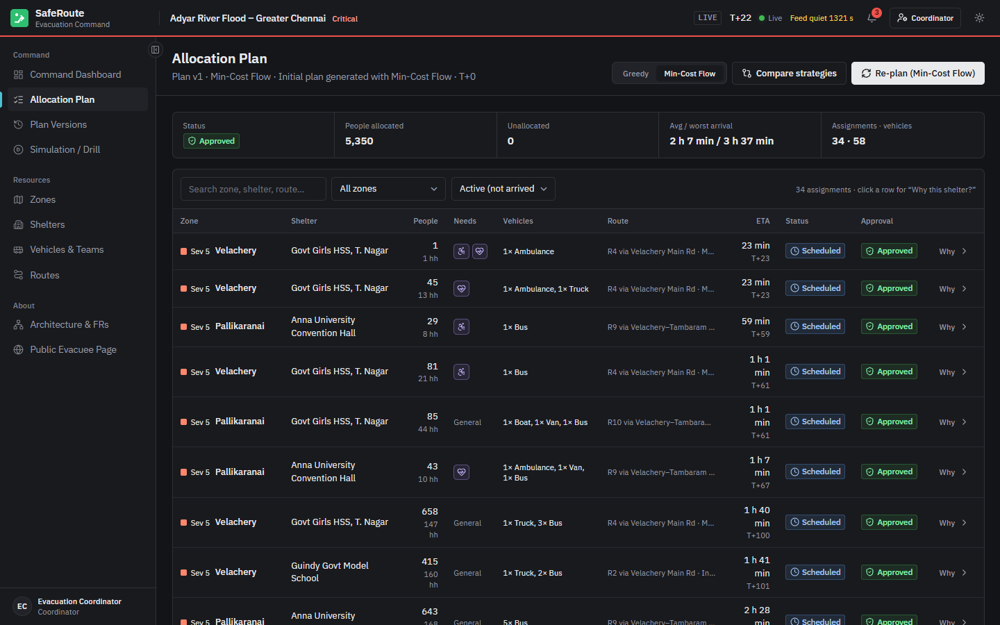
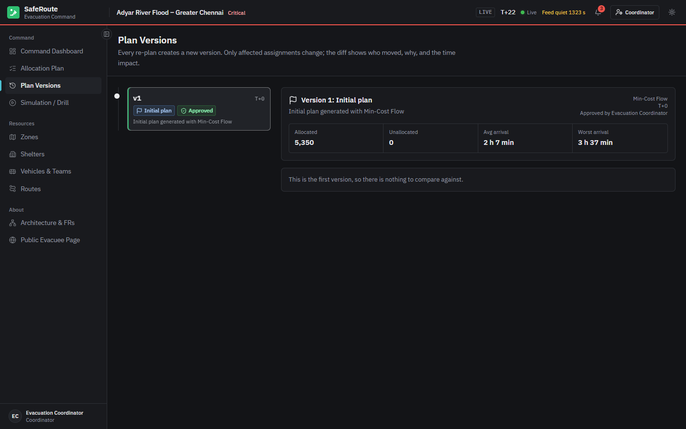
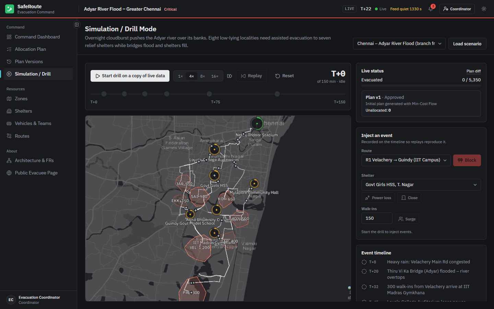
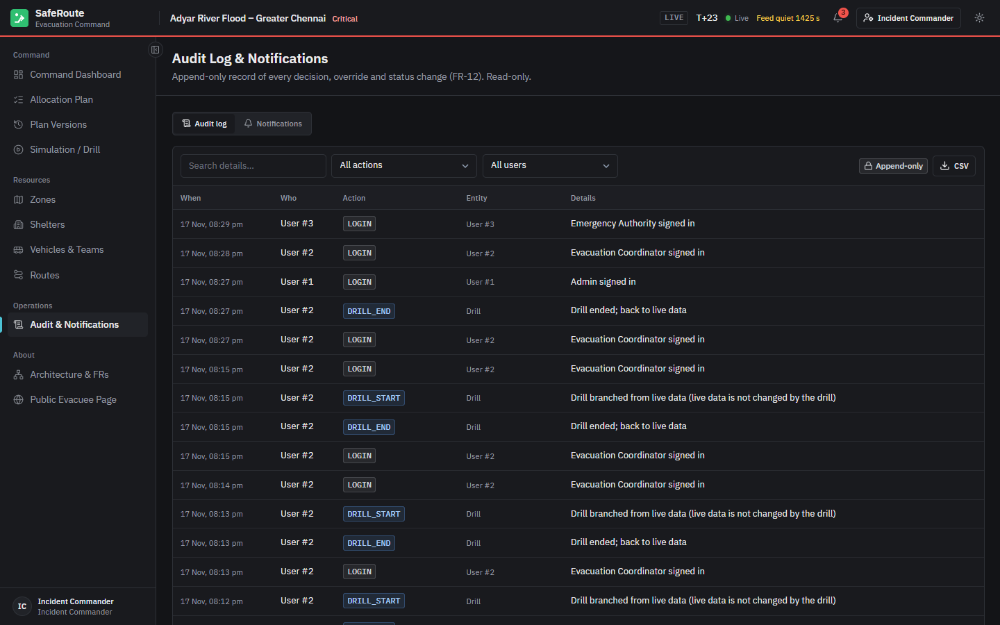
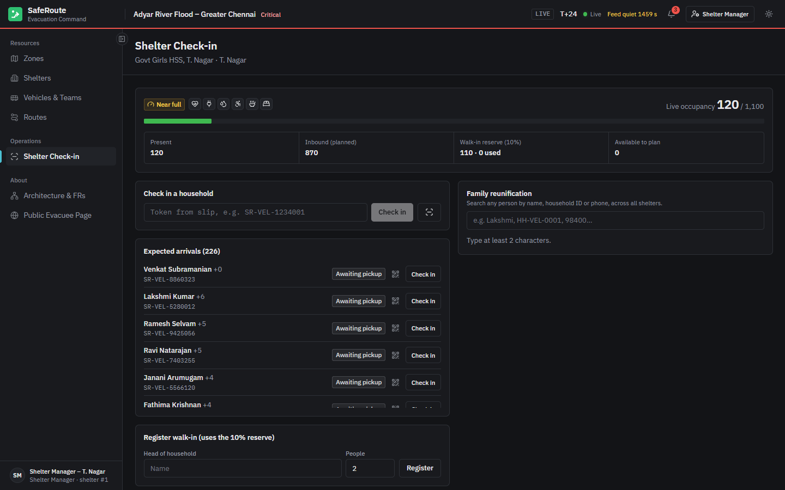
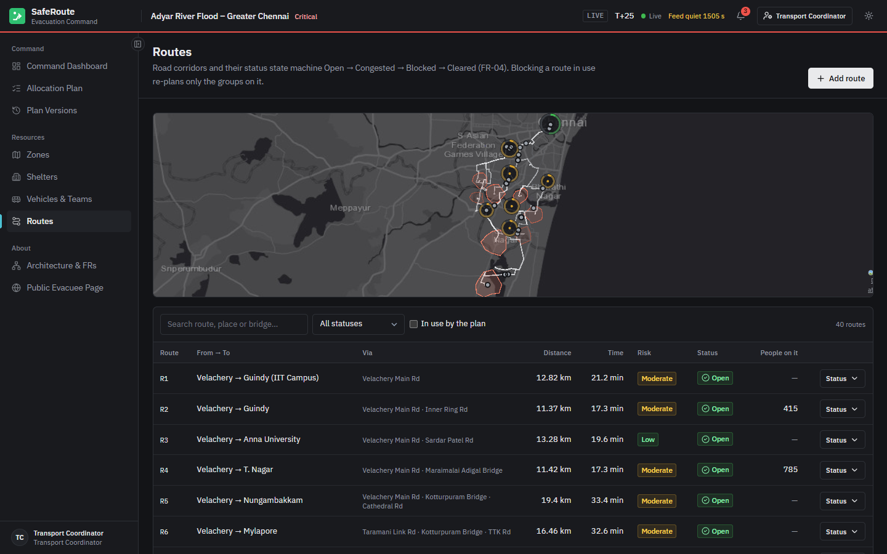
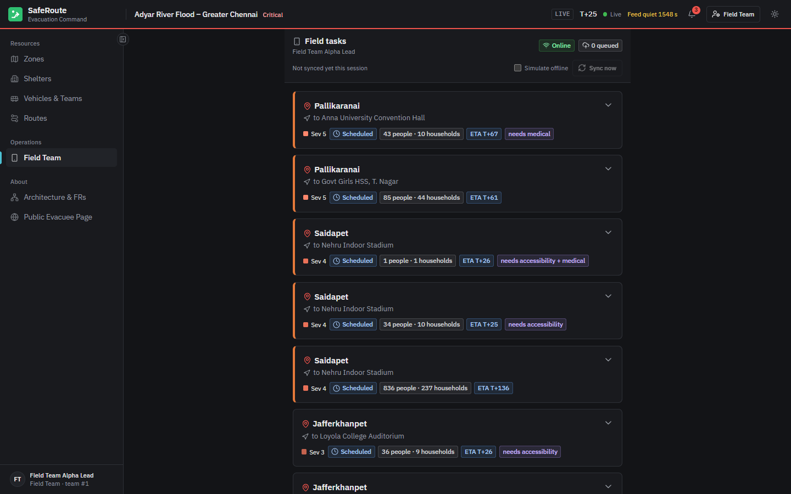
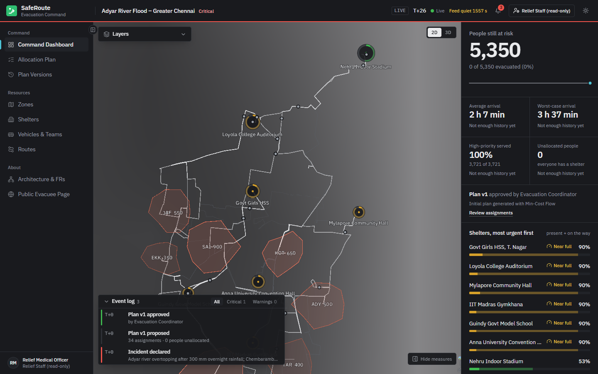
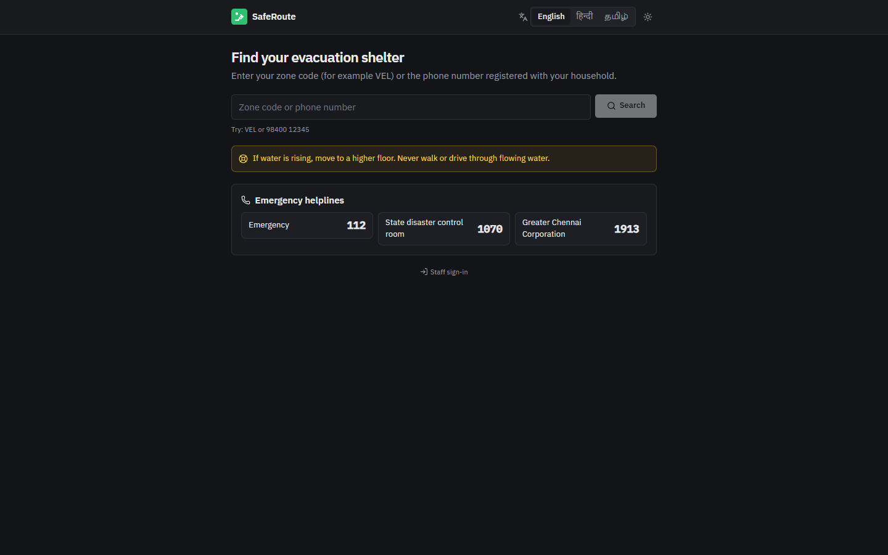

# SafeRoute user manual

SafeRoute helps an emergency control room move people from flooded or damaged areas to shelters. It
suggests a plan; people approve it. This manual is organised by role. The screenshots come from the
automated page sweep (`frontend/e2e/pages.spec.ts`) on the seeded Chennai Adyar flood scenario.

## Everyone

### Signing in

Open SafeRoute and sign in with your email and password. In the lab build, the login page also lists
one account per role; click a role to sign in as that role.

### The top bar

* **LIVE / DRILL / REPLAY**: which data you are looking at. DRILL means everyone is working on a
  practice copy; live data is not changed. REPLAY means a recorded feed is playing (development only).
* **T+21**: the operation clock, in minutes since the incident started.
* **Connection**: *Live* (green) – updates arrive by themselves; *Stale* (amber) – no update for 5
  seconds, so what you see may be old; *Disconnected* (red) – SafeRoute is reconnecting by itself.
  You do not need to reload the page.
* **Feed quiet**: no message from the field feed for a while.
* **Bell**: notifications, for example "REPLANNING v2".

### The map

The same map appears on the dashboard and, smaller, on the Zones, Shelters, Routes, Vehicles, Drill,
Field and Public pages.

* **Shelters** are rings. The ring fills with people present (solid) and people on their way
  (lighter). Its colour shows the status: Open, Near Full, Full, Closed.
* **Zones** are shaded areas. Darker means higher severity (1–5).
* **Routes**: unused roads are faint, roads in use are thin lines, congested roads are amber, and
  blocked or flooded roads are red and dashed.
* **Vehicles** move along their routes.
* Click anything on the map, or a row in a table, to open its details. *Layers* turns layers on or off,
  shows the legend and switches between 2D and 3D.

## Evacuation Coordinator

You plan the evacuation and keep it up to date.

1. **Command Dashboard**: people still at risk (the large number), evacuated, inbound, the current
   plan, and the shelters sorted by how full they are. The event log on the right shows what happened.
2. **Allocation Plan**: choose *Greedy* or *Min-Cost Flow* and press **Generate**. Each row is a group of
   families going to one shelter by one route. Click **Why** to see why that shelter was chosen, what it
   cost, and which alternatives were rejected and why. *Compare strategies* shows both strategies side by
   side without saving anything.

   
3. **Approve** the proposed version, or open a row and **override** its shelter with a reason (the reason is audited).
4. **Plan Versions**: every re-plan is a new version with *What changed* (who moved, ETA change). A new
   version is *Proposed* until someone approves it.

   
5. **Zones, Shelters, Routes**: you may also edit these (see the other roles).
6. **Simulation / Drill**: *Start drill on a copy of live data*, set the speed, play, and inject events
   (for example, block a route) to practise. *End drill, back to live* returns everyone to live data.

   

## Emergency Authority (Incident Commander)

Everything the Coordinator can do for plans and drills, plus:

* **Disasters and zones**: declare and update the incident and its affected zones.
* **Rescue teams**: create teams and change their status.
* **Resources**: record supplies (food, water, medical kits).
* **Audit & Notifications**: every important action, who did it, when and why.

  

## Shelter Manager

You see only your own shelter.

* **Shelter Check-in**: live occupancy, people on their way, the 10% walk-in reserve. Check in a family
  with the token on their slip (for example SR-VEL-1234001), or press **Check in** next to an expected
  family. **Register walk-in** for families who arrive without a plan. **Family reunification** finds a
  person in any shelter by name, household ID or phone.

  
* **Shelters**: change your shelter's status (Open → Near Full → Full → Closed) and mark facilities as
  unavailable. Closing a shelter or losing a facility makes SafeRoute propose a new plan for the
  families affected.
* **Resources**: update supplies at your shelter.

## Transport Coordinator

* **Routes**: add a route from a zone to a shelter through named roads, and change a route's status.
  Marking a road Blocked or Flooded re-plans every group that used it.

  
* **Vehicles & Teams**: add vehicles and change their status. Click a vehicle to follow it on the map.
* You can view the dashboard and the plan.

## Response Team (field)

* **Field Team**: your tasks in order. Tick each family as they board, or press **Mark all picked up**,
  then **Arrived at shelter** on arrival. The page works on a phone; with no signal, actions are queued
  and sent when the connection returns.

  

## Relief Staff and NGO Volunteer

Read-only: the dashboard, the plan, plan versions, and the zone, shelter, route and vehicle lists. Use
them to see where people are going and which shelters will need help. Nothing on these screens can be
changed from these roles.

## Administrator

Can open every page and do every action. Use it for setup and support, not for running an operation.

## Public (evacuees and families)

The **Public Evacuee Page** needs no login. Enter a zone code or phone number to see the assigned shelter
and how to get there. It is available in English, Hindi and Tamil.

