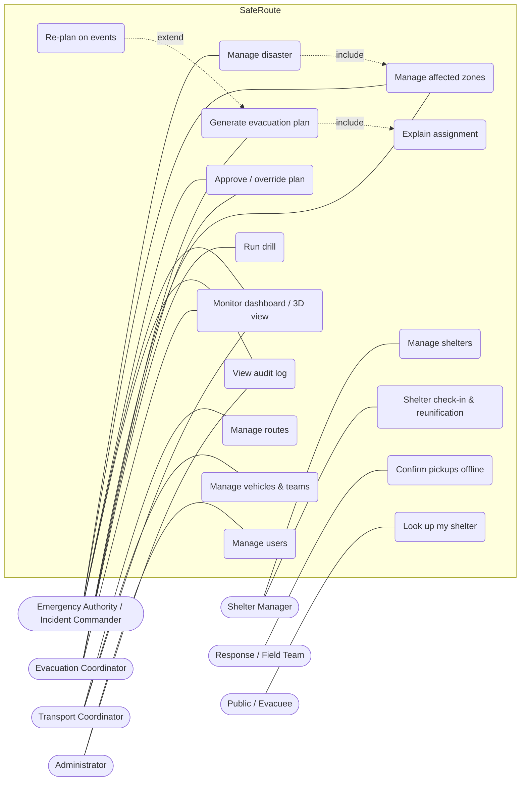
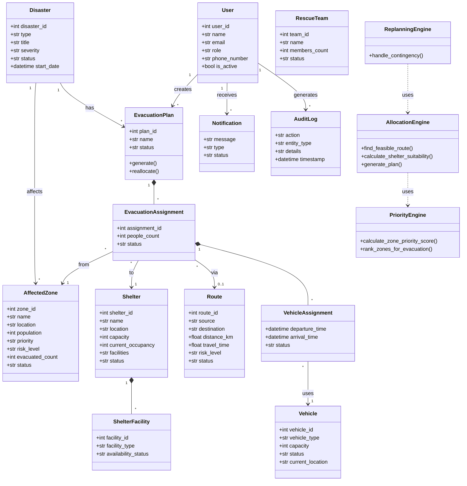
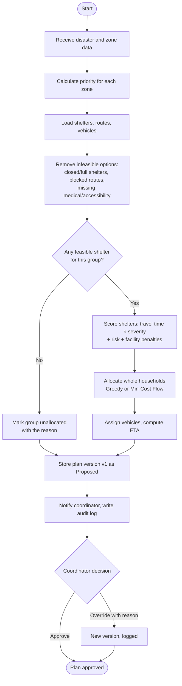
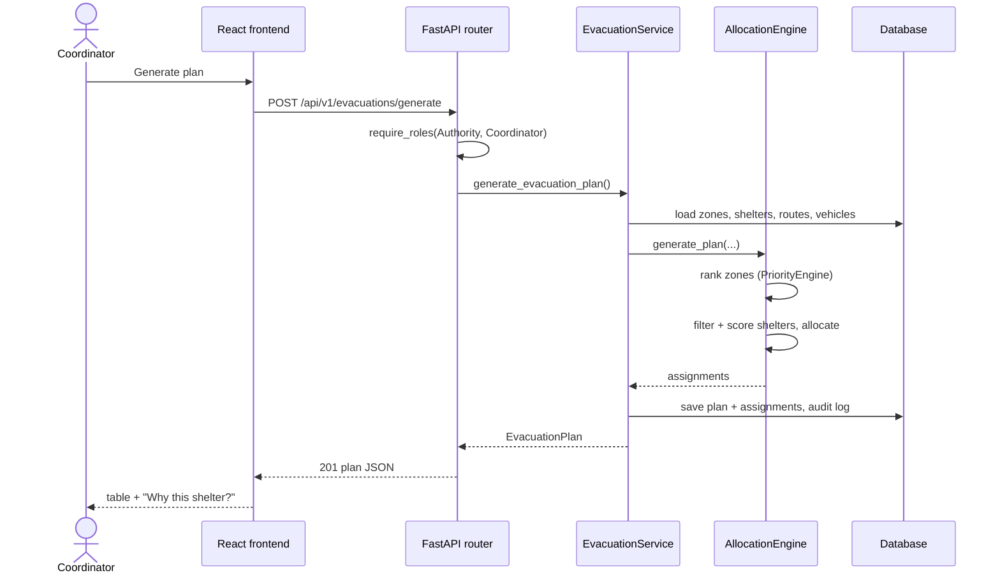
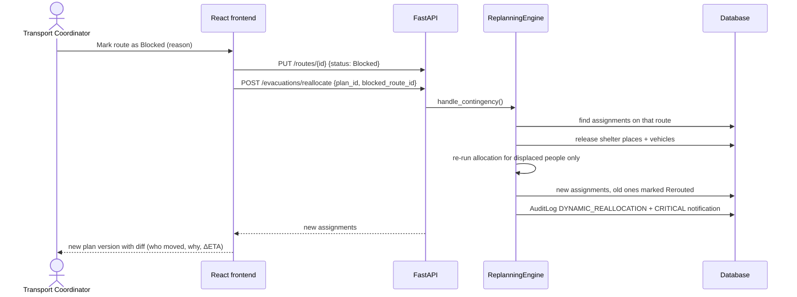

# Experiment 3 – UML diagrams

The hand-drawn versions are in our lab file. These are the same diagrams kept as code (Mermaid), so
they stay next to the source and are easy to update when the design changes.

## A. Use case diagram

## B. Class diagram (core domain, matches `app/models`)

## C. Activity diagram – generate an evacuation plan

## D. Sequence diagram – create a plan

## E. Sequence diagram – re-plan when a bridge floods

