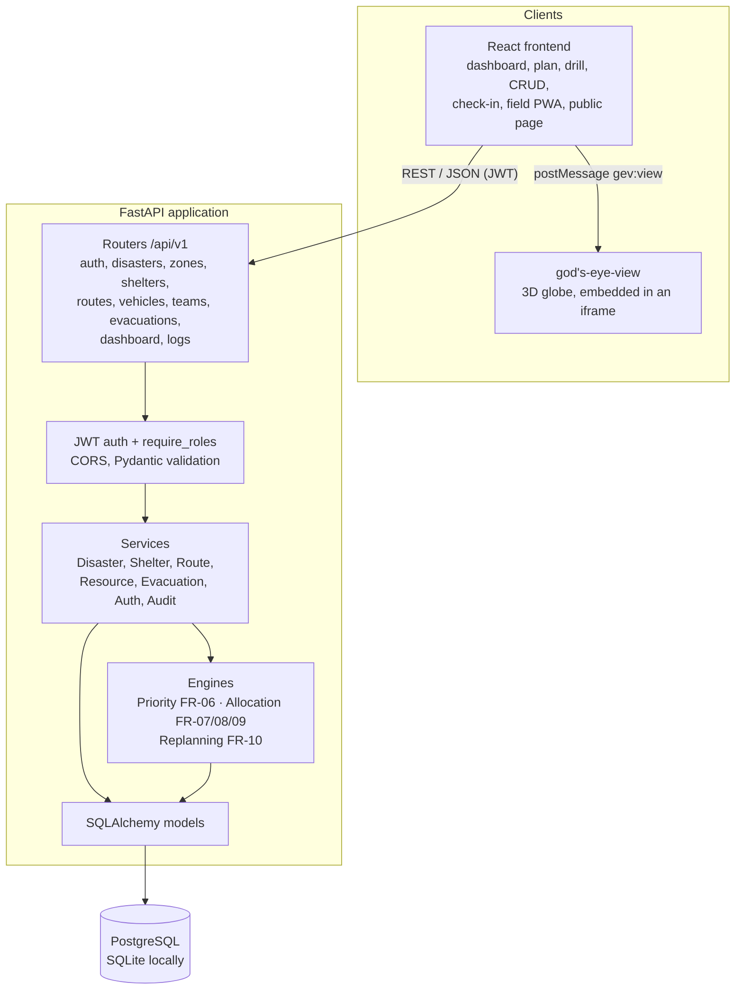

# Experiment 4 – Architectural design

We used a layered architecture rather than microservices. For a team of four and a prototype this
keeps deployment simple (one API process, one database) while still separating concerns cleanly.

## Layers

| Layer | Code | Responsibility |
|---|---|---|
| Presentation | `frontend/src/features/*` | Screens per role. Talks only to the `SafeRouteApi` interface. |
| API | `app/routers/*` | HTTP endpoints, request/response schemas (`app/schemas`), role checks |
| Business services | `app/services/*` | Use cases (create plan, re-allocate, dashboard summary), audit + notifications |
| Decision engines | `app/engines/*` (Python), `frontend/src/engine/*` (TypeScript port) | Priority, feasibility, scoring, allocation, re-planning. No HTTP or UI code inside. |
| Data access | `app/models/*`, `app/core/database.py` | SQLAlchemy entities and sessions |
| Database | PostgreSQL / SQLite | Persistent state |

## Frontend structure

The frontend has one interface (`SafeRouteApi`) with two implementations. `VITE_API_MODE` chooses:

* `HttpApi` calls the FastAPI backend and validates every response with zod.
* `MockApi` is an in-browser copy of the backend (same shapes and role rules) that we use for demos
  and drills when the backend isn't running. It stores its state in IndexedDB.

This made it possible to build and test screens before every endpoint existed, and it is the reason the
allocation engine also exists in TypeScript.

## god's-eye-view integration

[god's-eye-view](https://github.com/bilawalsidhu/gods-eye-view) (MIT, by Bilawal Sidhu) is a separate
open-source app: a photorealistic 3D globe with live public data (weather radar, wind, cyclones,
dams, flights and so on). We include it as a **git submodule** in `integrations/gods-eye-view` and do not
modify its code.

SafeRoute embeds it with its official embed mode (`?embed=1`). The SafeRoute page sends
`{type: "gev:view", view}` messages that set the camera, the live layers and up to 24 annotations
(our shelters, zones and closed roads), and god's-eye-view answers with `gev:view-applied`. Framing is
only allowed for the SafeRoute origin (`GEV_EMBED_FRAME_ANCESTORS`). The adapter is
`frontend/src/features/godseye/gev.ts`.

## Why this design

* Layers keep coupling low; the engines can be unit-tested without a server or database.
* Repository/ORM code is kept out of the routers, so business logic doesn't depend on HTTP.
* A REST API lets the frontend (and later a mobile app) evolve independently.
* Integrating god's-eye-view through messages instead of copying its code means we get its updates
  with `git submodule update`, and a bug on either side can't break the other.
* Modular without the deployment cost of real microservices.
