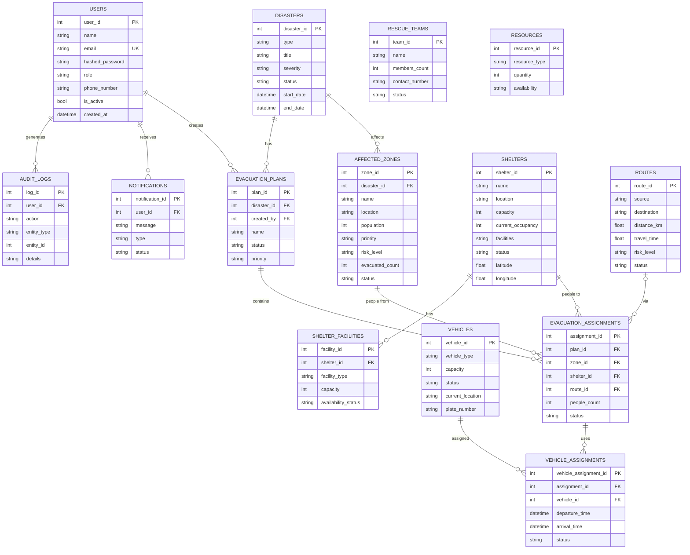

# Experiment 5 – Database design (ER diagram and relational schema)

PostgreSQL in production, SQLite for local development and tests. Tables are created from the
SQLAlchemy models in `app/models` (`Base.metadata.create_all`).

## ER diagram

## Constraints actually enforced

| Table | Constraint |
|---|---|
| users | `email` UNIQUE, NOT NULL; password stored only as a bcrypt hash |
| affected_zones | `population >= 0`, `evacuated_count >= 0`; FK → disasters |
| shelters | `capacity > 0`, `current_occupancy >= 0`, **`current_occupancy <= capacity`** |
| routes | `distance_km > 0`, `travel_time >= 0` |
| vehicles | `capacity > 0` |
| rescue_teams | `members_count > 0` |
| resources | `quantity >= 0` |
| evacuation_assignments | `people_count > 0`; FKs → plans, zones, shelters, routes |

Pydantic schemas repeat the same rules at the API boundary (e.g. `capacity: int = Field(gt=0)`), so bad
input gets a 422 before it reaches the database. `tests/test_reallocation_api.py` checks this.

## Normalisation

* **1NF:** every column holds one value; vehicles, facilities and assignments live in their own tables
  instead of lists inside a row. (`shelters.facilities` is kept as a display summary; the queryable
  version is the `shelter_facilities` table.)
* **2NF:** all tables use a single-column surrogate key, so there are no partial dependencies.
* **3NF:** non-key columns depend only on the key. A zone stores `disaster_id`, not the disaster's title
  or severity, so changing the disaster updates it everywhere. Assignments refer to the shelter and
  route by id instead of copying their names.

Planned arrivals are not stored as occupancy: `current_occupancy` is people physically present, and
"inbound" is computed from active assignments. That avoids two values that could drift apart.

## Extension tables (proposed)

The frontend needs a few extra records (zone geometry, households, plan versions, explanations).
They are keyed by the existing primary keys and listed in [`docs/api-extensions.md`](../api-extensions.md).
