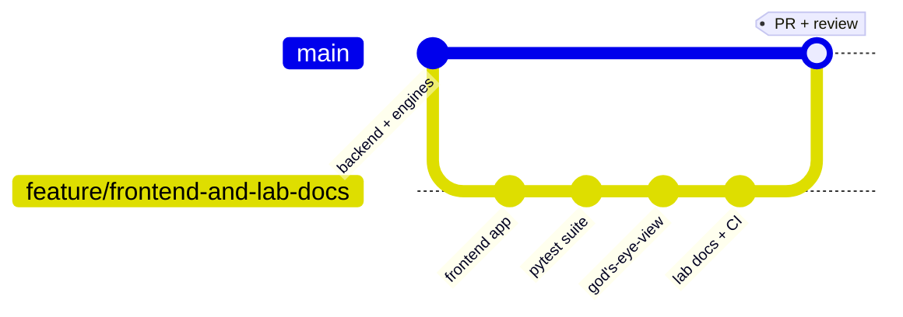

# Experiment 9 – Git repository, branching model, pull requests and code review

Repository: `SafeRoute-Backend` on GitHub (backend, frontend and docs together; god's-eye-view as a
submodule).

## Branching model

We use a simple feature-branch workflow (GitHub Flow):



| Branch | Use |
|---|---|
| `main` | Always runnable. Protected: changes only through reviewed PRs with green CI. |
| `feature/*` | New work |
| `fix/*` | Bug fixes |
| `docs/*`, `test/*` | Docs or tests only |

Rules, commit message style and the review checklist are in [`CONTRIBUTING.md`](../../CONTRIBUTING.md).

## Pull request process

1. Branch from `main`, commit in small steps (`feat:`, `fix:`, `test:`, `docs:`).
2. Push and open a PR; the template (`.github/pull_request_template.md`) asks what changed, why, and how
   it was tested.
3. GitHub Actions runs **Backend CI** and/or **Frontend CI** ([Experiment 10](exp10-ci.md)).
4. Another team member reviews: correctness, tests, role checks, no secrets, UI accessibility.
5. Reviewer approves → squash-merge → delete the branch.

## Branch protection to enable on GitHub

*Settings → Branches → Add rule for `main`:*

- [x] Require a pull request before merging (1 approval)
- [x] Require status checks to pass: `Backend CI / pytest`, `Frontend CI / check`
- [x] Require branches to be up to date before merging
- [ ] Allow force pushes (leave off)

## Submodule

god's-eye-view is pinned to a specific commit. After cloning:

```bash
git submodule update --init      # fetch it
git submodule update --remote    # later: move to the newest upstream commit (then commit the change)
```

> **TODO (team):** add links/screenshots of an actual PR with review comments for the lab file.
