# SafeRoute frontend

React + TypeScript web app for SafeRoute. The system proposes an evacuation plan, explains every
assignment, and re-plans when roads close or shelters fill up. A coordinator approves or overrides it.

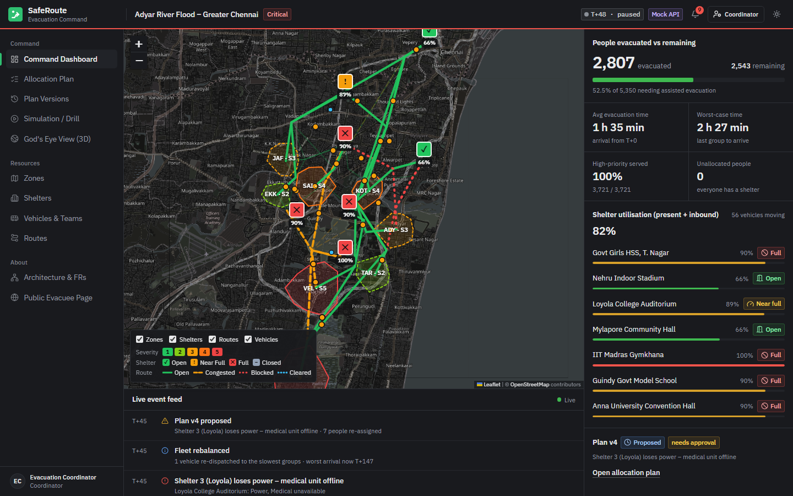

## Getting started

You need Node 20 or newer (we use Node 24).

```bash
cd frontend
npm install
npm run dev        # http://localhost:5173
```

That's enough to try everything. By default the app runs in **mock mode**: a copy of the backend that
runs in the browser (same response shapes and role rules as FastAPI), loaded with a Chennai flood
scenario and saved in IndexedDB. The **Reset** button on the Drill page puts the seed data back.

### Using the real backend

```bash
cp .env.example .env
```

Set `VITE_API_MODE=live` (and `VITE_API_BASE_URL` if the API isn't on `localhost:8000`), start the
backend from the repo root with `python run.py`, then `npm run dev`.

In live mode login, dashboard, CRUD, plan generation, re-allocation, audit and notifications all go to
FastAPI, and every response is checked against `src/api/schemas.ts`. Plan versions, explanations,
drills, check-in and the public lookup need new endpoints first; they're described in
[`docs/api-extensions.md`](../docs/api-extensions.md).

### God's Eye View (3D globe)

[god's-eye-view](https://github.com/bilawalsidhu/gods-eye-view) is included as a git submodule in
`integrations/gods-eye-view`. To use the *God's Eye View (3D)* page:

```bash
git submodule update --init     # once, after cloning
npm run gev:install             # once, installs its packages
npm run dev:all                 # SafeRoute on :5173 + god's-eye-view on :4173
```

`npm run gev` starts just the globe. Both scripts set `GEV_EMBED_FRAME_ANCESTORS`, without which
god's-eye-view refuses to be shown inside another page. No API keys are needed: it uses Esri satellite
imagery by default.

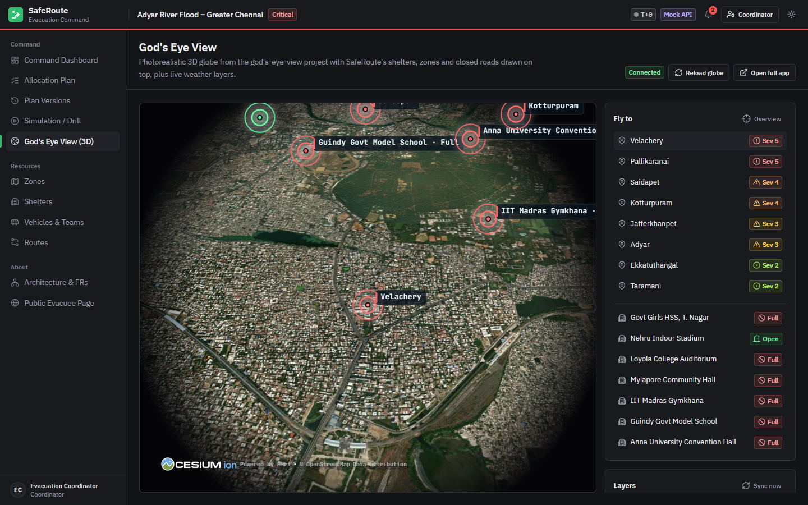

## Demo walkthrough

1. On the login page click **Coordinator**.
2. **Command Dashboard**: zones coloured by severity, shelters by how full they are, roads by status,
   vehicles moving. Click **Generate plan**.
3. **Allocation Plan**: click any row for *Why this shelter?* (cost breakdown and the reason every other
   shelter was rejected). Click **Approve**. **Compare strategies** shows Greedy against Min-Cost Flow.
4. **Simulation / Drill**: choose **16×** and **Start drill**. At T+20 the Thiru Vi Ka bridge floods,
   at T+32 walk-ins fill IIT Gymkhana, at T+45 Loyola loses power, at T+70 Guindy School closes. Each
   event re-plans only the groups it affects. **Inject an event → Block** blocks a road yourself.
5. **Plan Versions**: v1, v2, v3… with who moved, from where to where, why, and the time impact.
6. Open an assignment again and **Override** it. You have to give a reason.
7. **God's Eye View (3D)**: the same shelters and zones on a 3D globe, with live rain radar and dams.
8. Role menu (top right) → **Incident Commander** → **Audit & Notifications**: the override, every
   re-allocation and the approval are in the log.

Other roles:

| Role | Opens on | What to look at |
|---|---|---|
| Shelter Manager | Shelter Check-in | Only their own shelter; token/QR check-in, walk-ins, family search |
| Field Team | Field tasks (phone layout) | Pickup lists, route map, offline queue (tick *Simulate offline*) |
| Transport Coordinator | Dashboard | Vehicles and road status; can see but not change the plan |
| Evacuee (no login) | `/public` | Type `VEL` or `98400 12345`; English, हिन्दी, தமிழ் |

### Accounts (mock mode)

| Role | Email | Password |
|---|---|---|
| Admin | `admin@saferoute.org` | `Admin@12345` |
| Evacuation Coordinator | `coordinator@saferoute.org` | `Coord@12345` |
| Incident Commander (Emergency Authority) | `commander@saferoute.org` | `Command@12345` |
| Shelter Manager (T. Nagar, shelter 1) | `shelter.tnagar@saferoute.org` | `Shelter@12345` |
| Transport Coordinator | `transport@saferoute.org` | `Transport@12345` |
| Field Team Alpha (Response Team, team 1) | `field.alpha@saferoute.org` | `Field@12345` |

The first two are the same accounts `app/main.py` creates in the backend.

## Screenshots

| | |
|---|---|
| 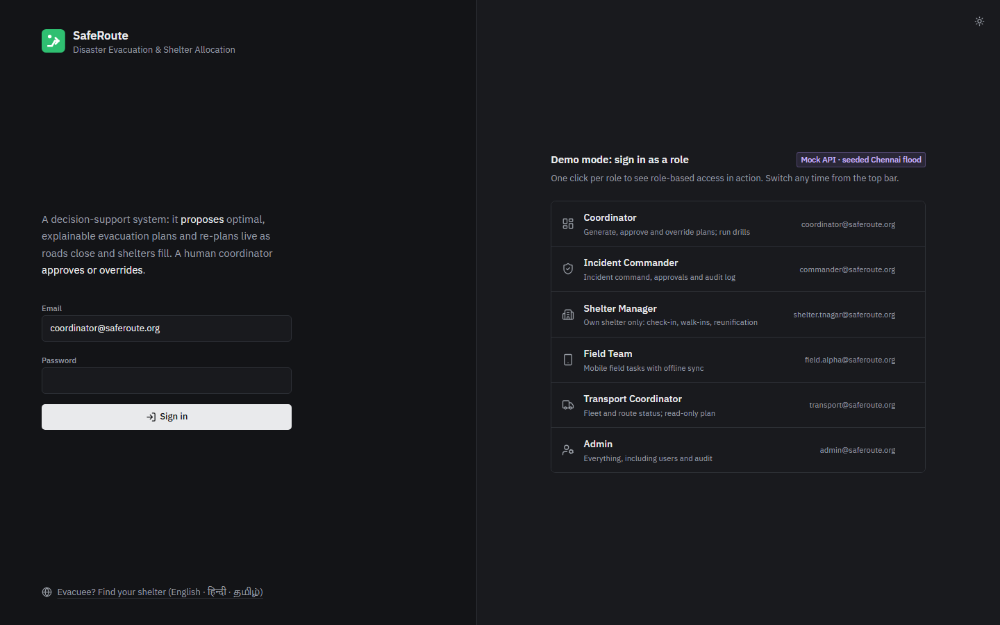 Login and demo roles | 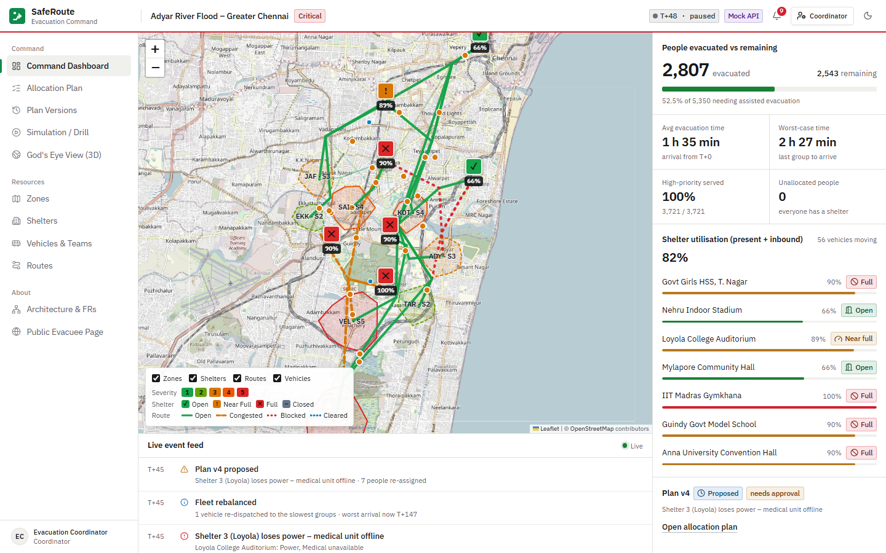 Dashboard, light theme |
| 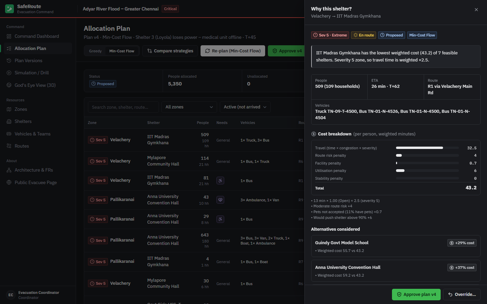 Why this shelter? | 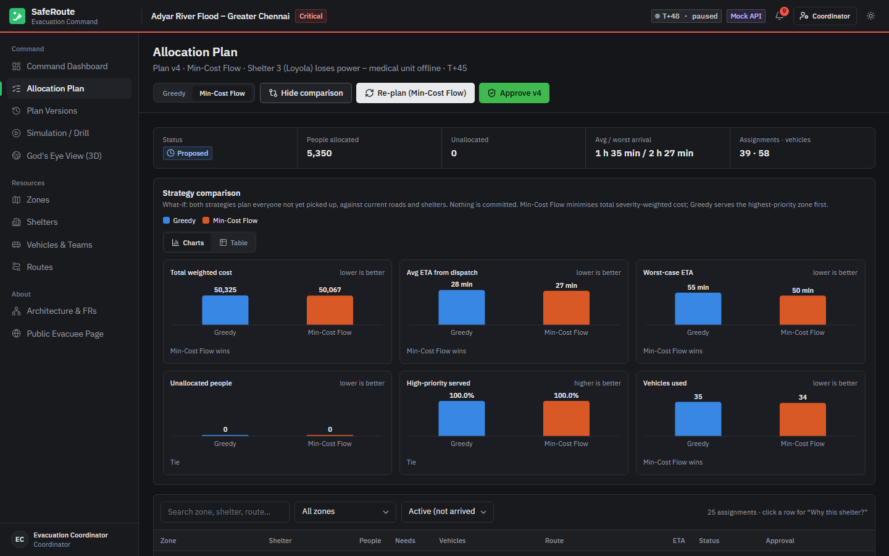 Greedy vs Min-Cost Flow |
| 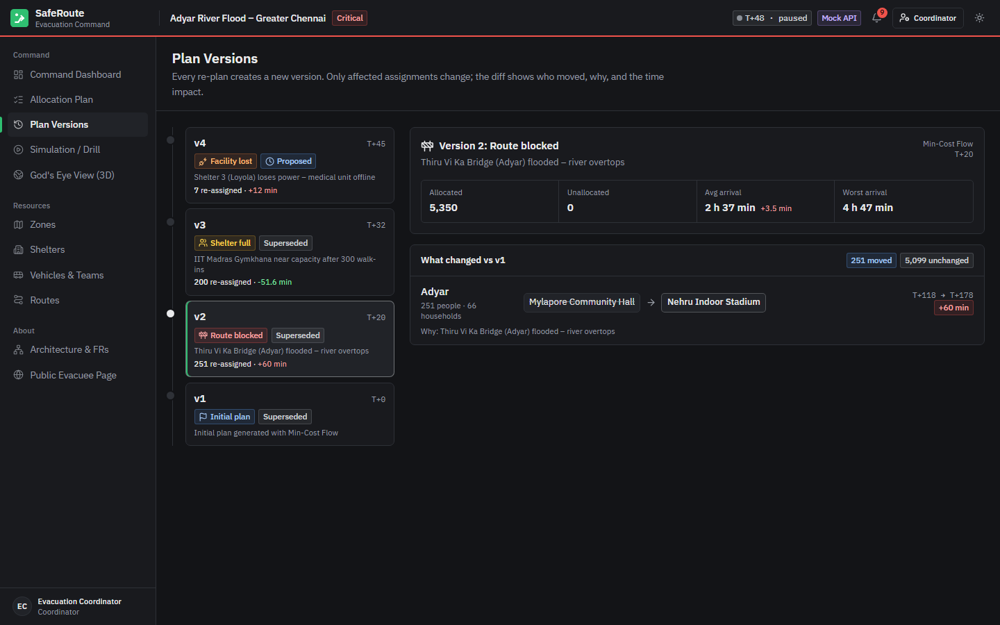 Plan versions and diff | 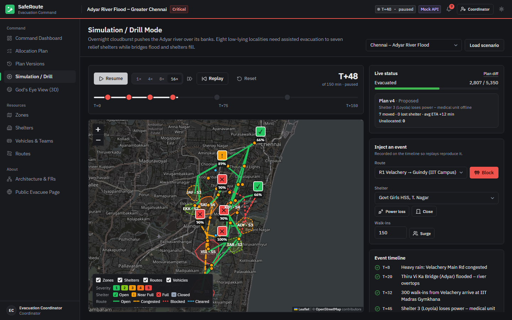 Drill mode |
| 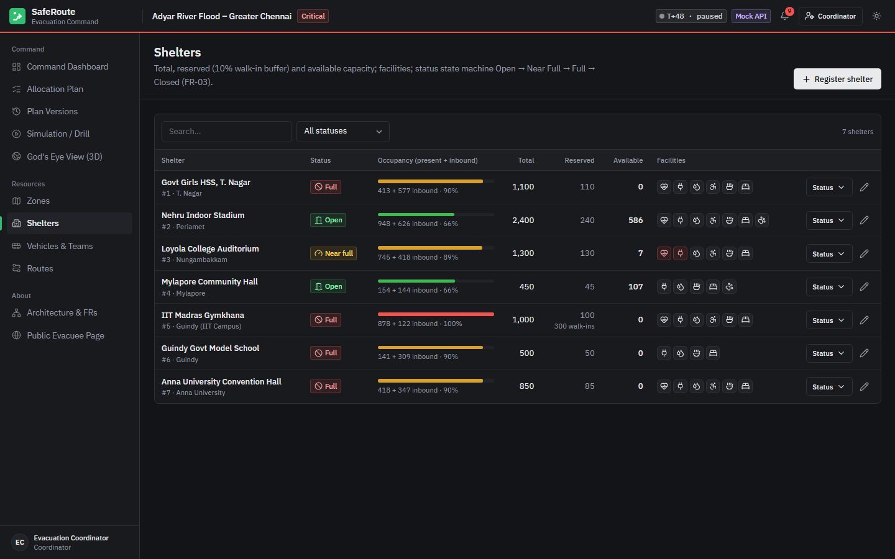 Shelters | 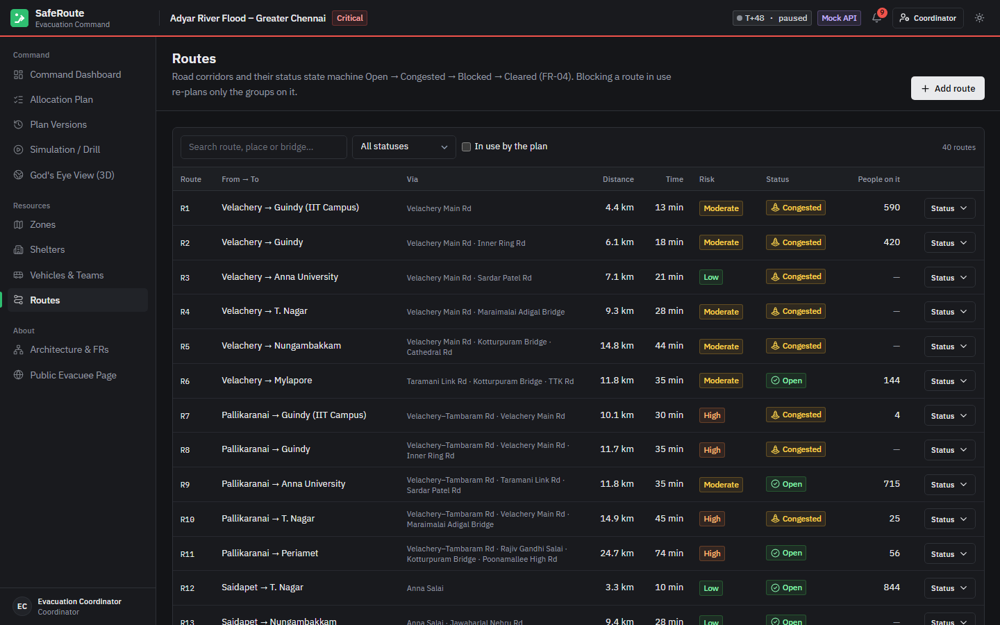 Routes |
| 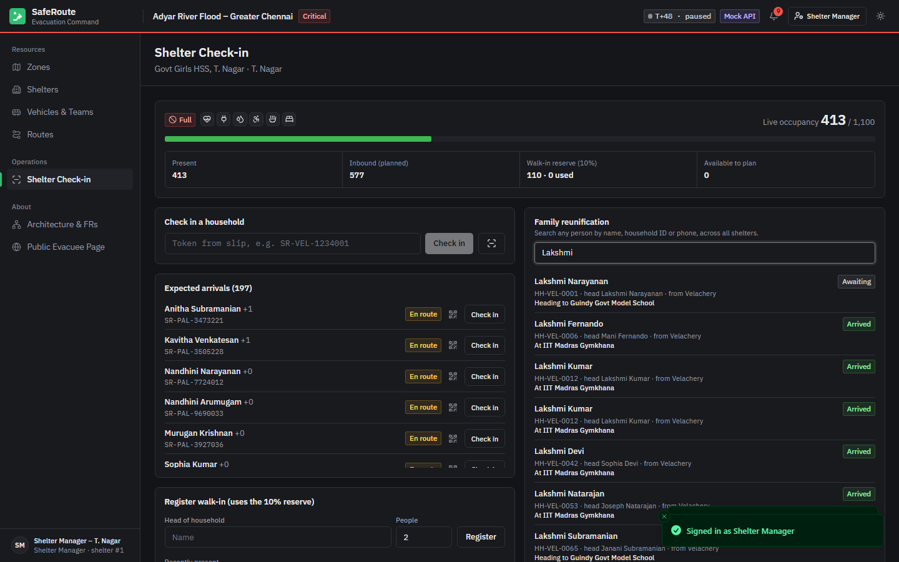 Check-in and family search | 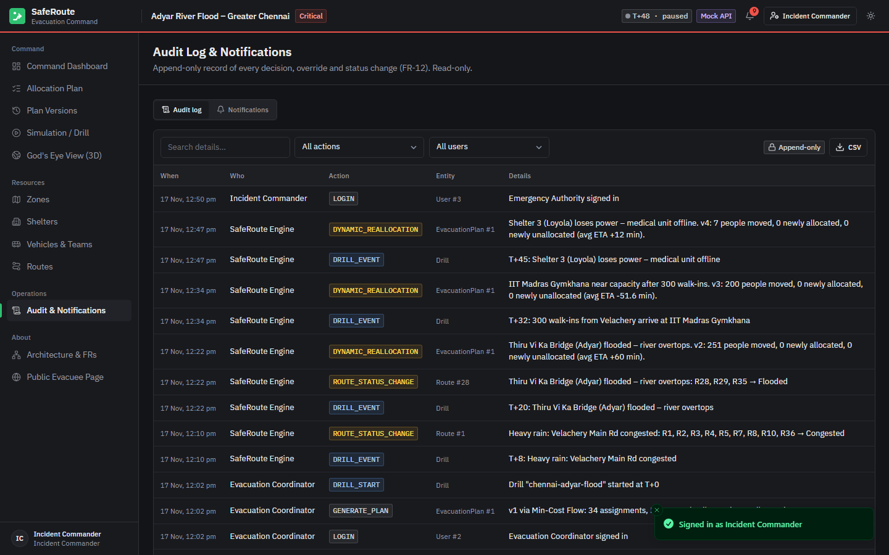 Audit log |
| 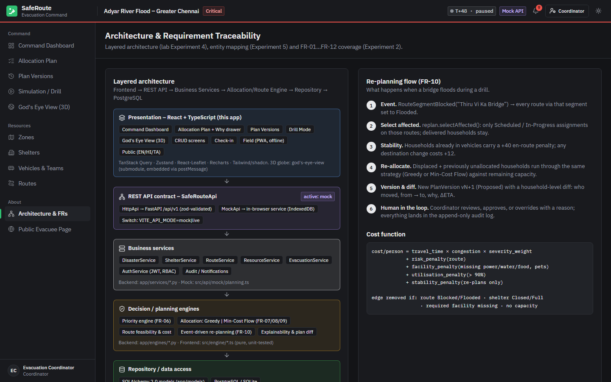 Architecture and FRs | 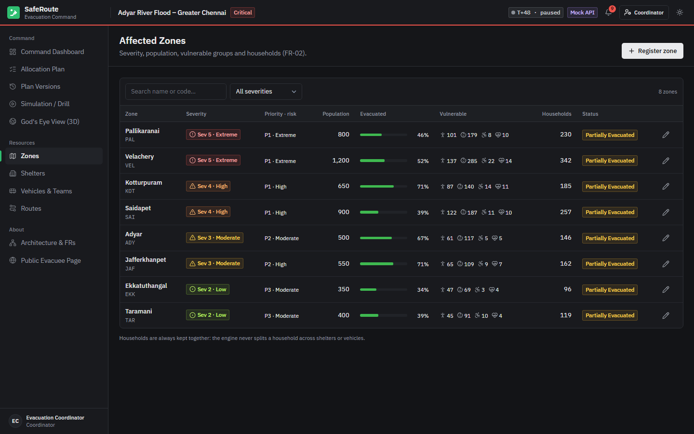 Zones |

<p>
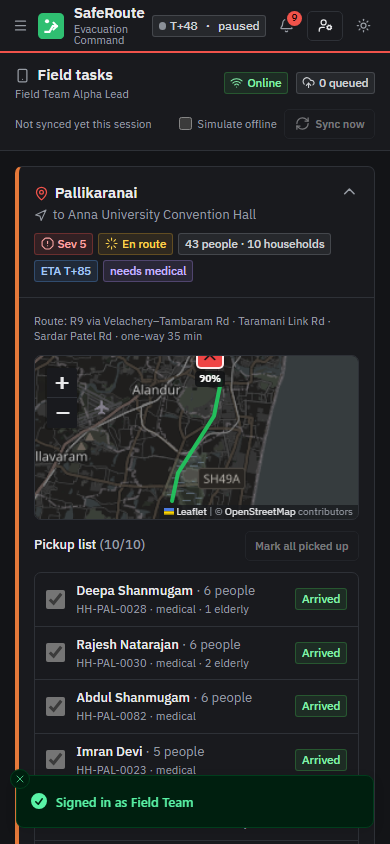
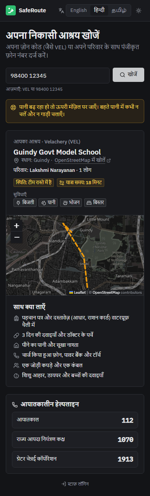
</p>

## How it's put together

```
screens ─> SafeRouteApi ─┬─> HttpApi ─> FastAPI /api/v1 ─> services ─> engines ─> SQLAlchemy ─> PostgreSQL
                         └─> MockApi ─> mock services ─> src/engine ─> IndexedDB
God's Eye View page ─ postMessage ─> god's-eye-view (iframe, ?embed=1)
```

* `VITE_API_MODE` picks the implementation in `src/api/client.ts`. Types come from zod schemas that
  copy `app/schemas/*.py`.
* **Engine** (`src/engine`, plain TypeScript, no React):
  * cost per person = travel time × congestion × severity weight, plus penalties for road risk, missing
    facilities, a shelter going over 90 %, and (when re-planning) moving a group that already had a
    destination;
  * a shelter is skipped completely if it's closed or full, every road to it is blocked, or it lacks
    something the group needs (medical, wheelchair access). 10 % of every shelter stays free for walk-ins;
  * two strategies with the same interface: **Greedy** (most urgent zone first, nearest shelter) and
    **Min-Cost Flow** (lowest total cost for everyone, then rounded back to whole households);
  * households are never split; vehicles freed by finished trips are sent to the slowest groups;
  * re-planning reacts to *road blocked*, *shelter full*, *shelter closed* and *facility lost*, and
    only touches the assignments those affect;
  * each assignment keeps the reason it was chosen; each re-plan is a new version with a diff.
* **Roles** (`src/lib/rbac.ts`) match `require_roles` in the backend. Shelter managers only see their
  shelter, field teams only their team's tasks.
* **Offline**: it's an installable PWA. The app shell and map tiles you've seen are cached, and field
  actions made offline wait in a queue that syncs when you're back online.

### Folders

```
frontend/
├── src/
│   ├── api/          schemas.ts, extensions.ts, SafeRouteApi.ts, client.ts
│   │   ├── http/     HttpApi (real backend)
│   │   └── mock/     MockApi, planning, drill engine, views, IndexedDB storage
│   ├── engine/       cost, allocate (Greedy + MCF), mcf, replan, diff, priority + tests
│   ├── seed/         Chennai flood scenario, random scenario generator
│   ├── features/     dashboard, plan, drill, godseye, resources, checkin, field, public, audit, architecture
│   ├── components/   ui (shadcn-style), map (React-Leaflet), status badges, layout
│   ├── hooks/ stores/
│   └── i18n/         English / Hindi / Tamil
├── e2e/              Playwright tests (+ screenshot script)
└── scripts/          gev.mjs, dev-all.mjs, make-icons.mjs
```

## Checks

| Command | Checks |
|---|---|
| `npm run typecheck` | TypeScript in strict mode |
| `npm run lint` | ESLint; `any` is not allowed |
| `npm test` | 43 Vitest tests (engine, god's-eye-view adapter, whole demo flow on the mock service) |
| `npm run e2e` | Playwright in Chromium; fails on any console error. First time: `npx playwright install chromium` |
| `npm run screenshots` | Regenerates `docs/screenshots` |
| `npm run build` | Production build + service worker |

Backend tests (PyTest) are in `../tests`; see [`docs/lab/exp08-unit-testing.md`](../docs/lab/exp08-unit-testing.md).

> **Windows:** run Vitest from `C:\...` with a capital drive letter. From `c:\...` (which some editors
> use) it loads itself twice and fails with "failed to find the runner".

## Extras

Things we added on top of the original brief:

* *Architecture & FRs* page mapping FR-01…FR-12 to screens, endpoints, code and tests.
* Seeded scenario generator (`src/seed/synthetic.ts`) for bigger stress drills (24 or 40 zones).
* Fleet rebalancing, the Greedy/Min-Cost Flow comparison, CSV export of the audit log, QR codes on
  evacuee slips.
* CI for frontend and backend, and the API extension spec for the backend team.

Lab write-ups for all 13 experiments are in [`docs/lab`](../docs/lab/README.md).
